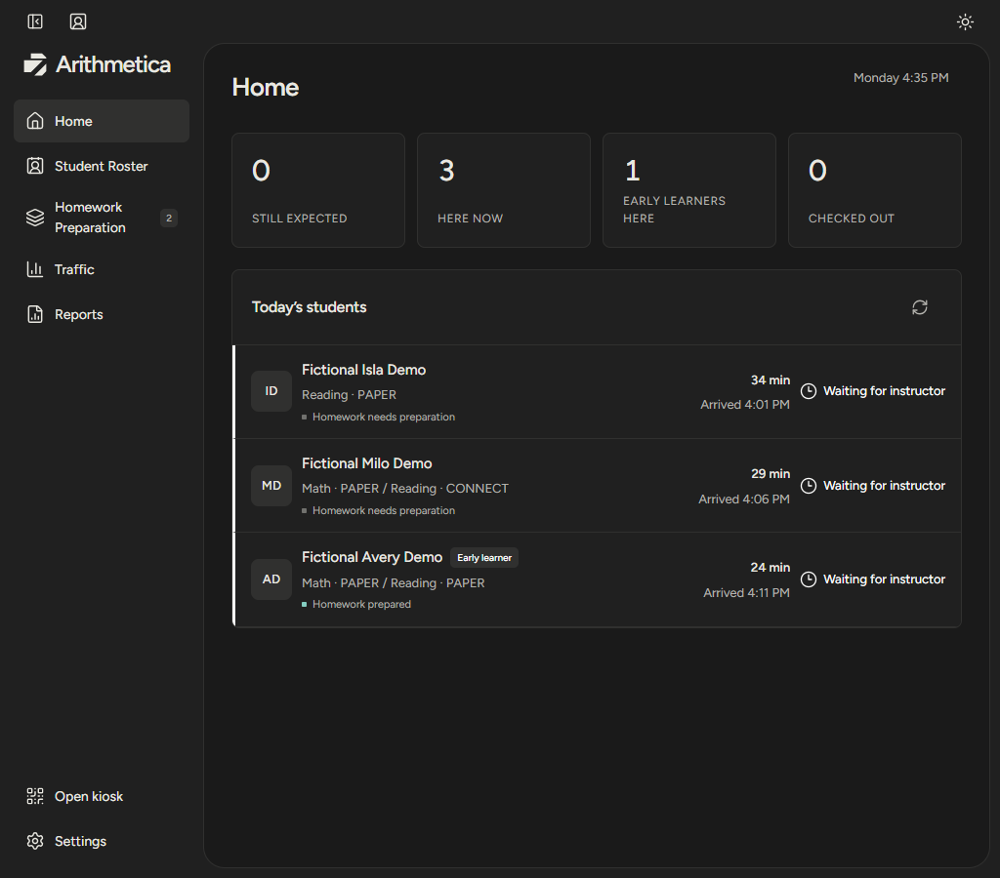

<p align="center">
  
</p>

# Arithmetica

[](https://github.com/isaiascampiz/arithmetica/actions/workflows/ci.yml)

Arithmetica is a learning center operations app for coordinating arrivals, worksheet preparation, instructor handoffs, and progress records. It keeps planned work separate from physical preparation and verified completion, so reports reflect what actually happened.



## What it covers

- **Arrival:** check students in by pouch code or exact name, see expected arrivals, and keep a visit history.
- **Preparation:** plan worksheets by subject, keep track of held packets, and record when materials are physically ready.
- **Instruction:** use Quick View for the next handoff and record observations without losing earlier notes.
- **Reporting:** review visits and observations alongside verified worksheet totals.

The interface is built with Next.js, React, and TypeScript. Server routes enforce staff permissions and run the same business rules against local demo data or Supabase. The deployed browser build uses Cloudflare; the API runs in Supabase Edge Functions. See [architecture](docs/architecture.md) for the boundaries and [the code guide](docs/code-guide.md) for entry points.

## Try the local demo

Use Node **24.20.0** and pnpm **11.25.0**. From a fresh clone:

```sh
git clone https://github.com/isaiascampiz/arithmetica.git
cd arithmetica
corepack pnpm install --frozen-lockfile
corepack pnpm dev
```

Open [http://127.0.0.1:3000](http://127.0.0.1:3000) and sign in with `owner@demo.center` / `CenterDemo!2026`. This local demo uses fictional students and needs no cloud credentials or `.env.local` file. To change the defaults, copy [.env.example](.env.example) to `.env.local`. Other demo roles are listed in [operations](docs/operations.md); Windows setup and test isolation are covered in [development](docs/development.md).

## Check a change

```sh
corepack pnpm lint
corepack pnpm typecheck
corepack pnpm test
corepack pnpm build
corepack pnpm test:e2e
```

Browser tests use a separate fictional data file. The [contribution guide](CONTRIBUTING.md) covers formatting and repository checks. Historical identifiers remain where saved records or printed pouch labels depend on them; see [compatibility](docs/compatibility.md).

Student records, backups, and credentials are excluded from this repository. The screenshot shows fictional demo students. Real student use requires organizational privacy approval and a validated deployment; see [security and data handling](SECURITY.md). The app has no Kumon integration.
