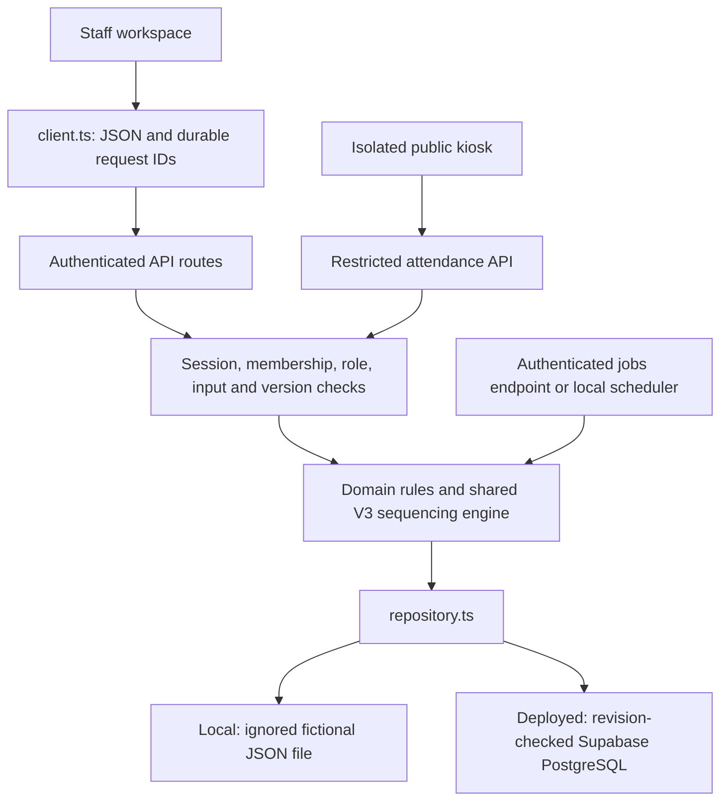

# Arithmetica architecture

Arithmetica shares one set of domain rules across a local Next.js Node application and a Cloudflare/Supabase deployment. Interface folders do not change saved schema versions or command protocols.

## Source boundaries

- `src/app/`: route entry points, HTTP handlers, and ordered global styles.
- `src/components/`: feature folders; shared controls in `ui/`, preserved earlier screens in `legacy/`.
- `src/lib/`: models, domain commands, read-only projections, authorization, and persistence. Version prefixes identify stored/command contracts.
- `src/server/`: Supabase Edge request adapters and the Cloudflare static proxy.
- `supabase/migrations/`: immutable ordered SQL, extended only through additive migrations.

See the [code guide](code-guide.md) for entry points. Earlier detailed implementation notes are preserved in [architecture history](history/architecture-2026-10-29.md).

## Runtime

Locally, Next.js serves pages and APIs. Builds use `ARITHMETICA_BUILD` to prevent scheduler startup during compilation. Data defaults to `data/demo-v1.json`; that historical filename is deliberately preserved.

For deployment, `scripts/static-build.mjs` generates browser entry points importing the same feature components. `scripts/edge-build.mjs` bundles existing API handlers for Supabase. Cloudflare serves static assets and a fixed-project proxy. Privileged database/session credentials stay in the backend. Code deployment does not initialize or replace student records.

Visible staff pages refresh authorized state and discard stale responses. Hidden pages pause polling; restored browser-history pages reload before trusting private state. Cloud errors fail visibly without a local-data fallback.

## Authorization and privacy

The server verifies identity, active membership, role, input, expected versions, and request ownership. UI role selection is not authorization. State responses exclude private request maps and expose only the signed-in staff member's account metadata.

The public kiosk receives no roster, staff records, grades, observations, IDs, or pouch tokens. The user-authorized exception permits one uniquely matching active student's name after at least three letters, plus that student's name in a confirmed attendance receipt. Ambiguous prefixes wait for more input. Pairing a shared kiosk clears staff cookies.

Authenticated records stay in memory, outside browser storage and service-worker caches. Only non-record device preferences use local storage. The offline shell has no private records. Dictation requires documented provider-specific privacy approval before real use; audio is never recorded.

## Persistence and retries

Local writes use locking and atomic replacement. Cloud writes use revision-checked compare-and-swap operations. Invalid/unsupported data fails closed. Only a missing local file may initialize fictional data. Explicit migration steps preserve IDs, timestamps, observations, attribution, and migration history, with backups.

New commands carry durable request IDs and reject reuse with different content. Stale profile/orientation/configuration versions are rejected. Cloud callbacks may retry; external effects and workbook generation occur outside them. Existing database identifiers, prior data formats, and printed pouch codes remain supported; see [compatibility](compatibility.md).

## Domain invariants

Physical attendance, preparation, issuance, instructor handoff, reported returns, and verified worksheet completion remain distinct. Planning and routine receipt assumptions never create completion evidence.

Preparation and Quick View share `v3-planning.ts`. Commands enforce catalog bounds, held material, physical packet identity, explicit progression/restart approval, and per-subject CONNECT eligibility. CONNECT creates no ordinary paper preparation. Corrections-only is an activity; started classwork creates no incompletion tracker. Hidden family/calendar/vacation workflows stay outside active navigation.

Reports freeze source evidence and retain earlier payloads and revisions. Worksheet exports use explicit attributed verification. Progress projections read saved evidence without fabricating data points or changing attendance.

## Operational evidence

The [deployment/recovery runbook](deployment-and-import-plan.md), [hosting guide](cloudflare.md), and [October 29 release review](release-review-2026-10-29.md) record the existing deployment validation. They do not automatically validate a new environment. Development and CI use isolated fictional data without contacting operational databases.
