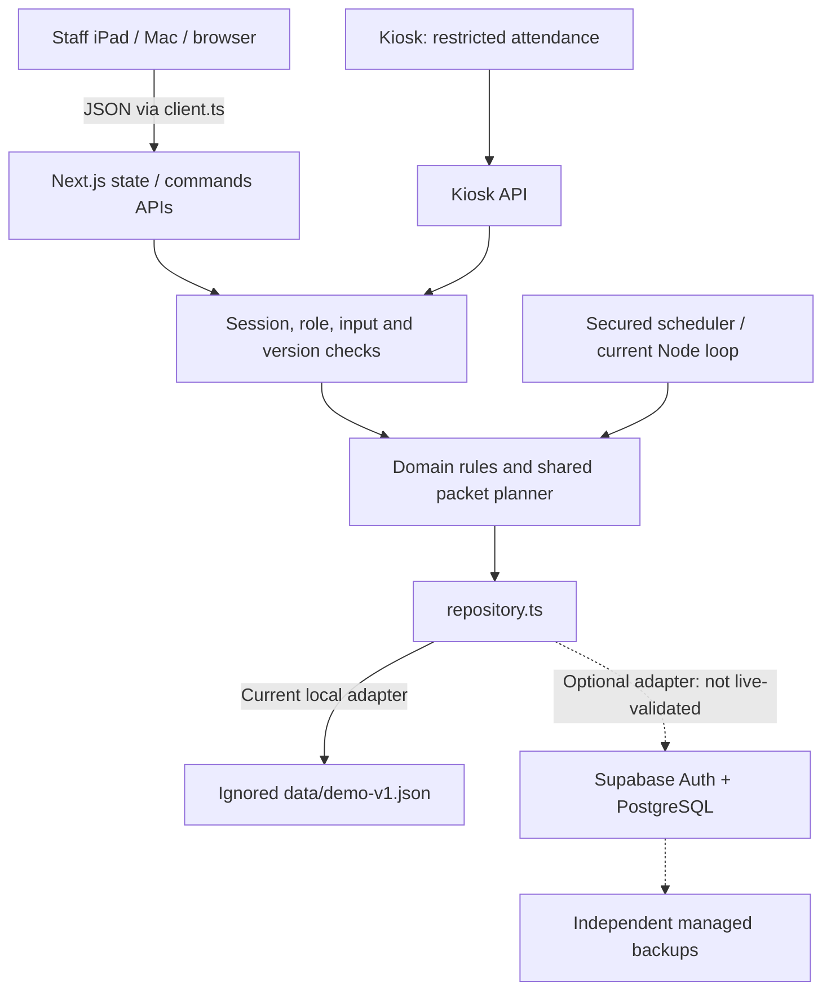

# Centerflow V3 architecture

## Current Arithmetica refinement

The continuous-workspace follow-up is specified in `.plans/arithmetica-continuous-ui-spec.md`. `student-directory-toolbar.tsx` is shared by Roster and Homework Preparation, including one filter dialog and common sort choices from `student-directory.ts`. `home-preparation.ts` presents unissued preparation, explicit issuance and temporary paper states without issuing or verifying work. `center-attendance.ts` drives one linked period/student selection for the summary, dense chart and punch list; matching-weekday averages appear only in Daily/Weekly. The chart has a single large keyboard/touch inspection surface plus an accessible data table. Reports uses one continuous section rail rather than separate metric tiles. `Modal.footerInBody` puts Quick View's action after its scrollable fields. These are presentation/read-model changes; no persistent schema, authorization or command semantics change. The geometric brand is shared across SVG/PNG/PWA assets, and reception's local decorative accents do not change graph colors.

The October 28 refinement uses `profile-overview.tsx` for balanced readouts and native modal editors. `punch-history.ts` derives one filtered source for period buckets and the optional attendance list, reusing Progress calendar policies. `report-view.ts` partitions frozen visits by observation evidence and aggregates worksheet exports. `ReportDetail` retains version 2 and adds optional worksheet-summary, evaluation and decision metadata; previous snapshots and migration history are untouched. The monthly workbook uses frozen names/grades and explicitly verified sheets, with ten-sheet reporting equivalents independent of physical packet sizes. Daily/weekly Excel requests are rejected; legacy archive and CSV APIs remain compatible. Reception supports existing-token keyboard/HID scans with Enter alongside name entry, while retaining durable receipts and server-only name resolution.

The visual reference is the installed Wispr Flow Windows app 1.6.1297 and public website. Shared Figtree/EB Garamond fonts remain locally hosted under OFL licenses; `identity.css` supplies tokens and `refinement.css` consolidates the current component treatment. Dark is the initial appearance, with a shared Light/Dark/System provider across sign-in, workspace and reception. Native popovers and dialogs supply focus/dismissal behavior; movement respects reduced motion. General-first settings remove redundant controls while retaining their saved values and compatibility commands.

The additive optional V3 `staffProfiles` and `accountRequests` fields hold self-scoped versioned display metadata and request fingerprints. `staff-profile.ts` validates reads and writes, checks request ownership/reuse and rejects stale changes and unsupported images. Verified authentication supplies the profile key; UI role selection cannot set it. Account saves never rename existing staff attribution. `/api/account` returns only the signed-in profile; `/api/state` removes both maps and includes only that person’s display name/picture beside their original staff identity. Local deactivation is credential-confirmed and preserves center history; cloud removal is deliberately unavailable pending a validated provider process. There is no schema reset, SQL migration or live cloud operation.

`/reception` and `/api/reception` require staff authentication and allow returning Home. Pairing the public `/kiosk` through the existing API still clears staff cookies and forbids private records. `receptionEntry` resolves exact normalized full names on the server, refuses duplicate/unknown/inactive names without returning a roster, and delegates to the existing scan debounce and attendance command. Pouch tokens remain unchanged; duplicate persisted tokens fail closed. The new authenticated print page renders an existing token and name into a 2-inch square label.

`closeDueVisits` applies mandatory V3 administrative closing while retaining earlier-version behavior. It appends closure/audit events and leaves physical departure unknown. `runDueJobs` uses V3 closing time for report due time; earlier versions keep their saved policy. State requests catch up jobs and reception scans catch up closing before attendance. Unattended execution continues to use the existing worker or secured jobs endpoint. A matching administrative closure does not require routine reconciliation before a new V3 arrival; other anomalies retain their checks. Reports continue to freeze original payloads and preserve archive versions. The new center-name alias changes presentation/new report detail without rewriting archived records.

## Beginner map

The frontend draws the screens; the backend checks and saves changes. Next.js supplies both in one project.

A future Cloudflare host would run the application/API after adapter validation; each iPad would use the same shared server. GitHub stores source, VS Code edits a local checkout, and Codex Cloud runs coding tasks in a separate checkout. None automatically synchronizes runtime student records. See `cloudflare.md` before a future hosting decision.

## Implementation reference

V3 extends the original Next.js application and preserved V2 operations aggregate. It does not create a second app or a new database. V1/V2 domain modules remain for historical compatibility; new daily UI calls V3 commands.

| Module                                   | Responsibility                                                                                                                                                                   |
| ---------------------------------------- | -------------------------------------------------------------------------------------------------------------------------------------------------------------------------------- |
| `model.ts`, `v2-model.ts`, `v3-model.ts` | Existing students/history plus optional visit handoff, student configuration and packet-level fields on existing assignments                                                     |
| `v3-migrate.ts`                          | Explicit schema 2 → 3 addition; preserve original arrays, old settings/records, medals and reports; unknown enrollment dates remain null                                         |
| `v3-planning.ts`                         | One sequencing engine for preparation and Quick View; calendar-day quantities, exact identities, catalog stops, held-packet reuse, recommendations and continuous roster sorting |
| `v3-domain.ts`                           | Validated, role-checked preparation/handoff/receipt/override/repeat/absence/shortcut/catalog commands; stale versions and attribution                                            |
| `v3-analytics.ts`                        | Same-subject filters, deterministic legacy visit matching, verified durations, independently weighted occupancy using real DST intervals                                         |
| V3 components                            | Lightweight Quick View, compact pulling list, directory filters, three-section profile and three relevant student charts                                                         |
| Existing repository/auth/report APIs     | Locks/atomic disk writes or Supabase CAS, durable command IDs, active membership verification, restricted kiosk, append-only reporting versions and jobs                         |

Commands are `{kind:'v3', command:{action:...}, requestId}`. The existing server API maintains idempotency and permissions. Paper-set versions and expected handoff timestamps reject competing edits. Optional observations can be added after departure without a second handoff. Assistants cannot perform instructional actions.

## Truth and physical packets

Physical arrival/departure and instructor handoff are independent. Administrative closure leaves actual departure null/unverified. Every attended session retains its own identity, including repeat same-day visits. The Home roster sorts waiting, ready and departed visits without separate panels.

V3 adapts existing Assignment records through optional `v3` data: visit date, one in-center packet, recommended take-home packets, actual issued packets, held packets, preparation/issuance attribution, version, review and receipt events. Subject + level + exact range is structured identity, not a parsed display string. Packet IDs retain origin when physically reissued. Prepared sets are not silently replaced; changed requirements flag physical adjustment.

The catalog has explicit identifiers/order/bounds and review sources. Unknown legacy Reading identifiers are retained, not guessed into subdivisions. Out-of-bounds ranges produce a review state before any physical pull list. A confirmed position change is an academic decision. One-time repeat preserves the ongoing cursor; explicit restart is separately recorded. Actual manual sets and held ranges inform next preparation.

Incoming no-exception is a planning assumption. Finished/unfinished/missing receipt reports are not verified completion ledger entries. Missing packets cannot become physically available through assumption. Corrections-only shifting applies per subject to entirely unstarted in-center work. A started packet going home requires no classwork-incompletion workflow.

## Migration, persistence and security

The same local file upgrades forward with untouched V1/V2 backup copies. Corruption never causes reseeding. Transactions use a bounded directory lock and atomic replacement; no-op transactions avoid revision growth. The cloud adapter uses revision compare-and-swap and retries side-effect-free callbacks; cloud failures never use local fallback.

The V3 SQL migration permits schema 2/3 payload compatibility, records target schema on commit, and retains existing payload/recovery tables and service-role-only access. No SQL was applied live. Real Auth/RLS/tenant isolation and disaster recovery require external validation. Never run resets or use empty-state provisioning over occupied state.

Records are served through role-filtered APIs. Kiosk pairing removes staff cookies and never exposes private snapshots. The service worker caches only installation assets and a generic offline page; offline mutations are unsupported. No audio files are stored. Browser dictation/provider behavior needs privacy approval.

## Charts and history

Center Activity pairs recorded arrival counts (accent) with historical arrival averages (muted) on a shared scale, with exact values and sample coverage in a hover/focus/tap inspection strip, using daily hourly columns or a Monday–Sunday week. `center-arrivals.ts` compares up to eight prior matching weekdays before the displayed period; it excludes recorded closure dates, future timestamps and dates before the first recorded arrival. Within that coverage, days without recorded punches contribute zero; missing attendance cannot be distinguished from a quiet day. Averages estimate arrivals, never simultaneous occupancy or verified attendance. Current-hour/day columns are explicitly partial; future actual values are absent. Existing elapsed-time occupancy calculations and their regression cases remain in `v3-analytics.ts`.

Previously saved weekday chart windows remain compatible; the separate hours editor is retired from the active UI. Optional `v3.activityHours` defaults preserve existing records; its version and full weekday set are validated on the server and repository reads. The additive `activity-hours` command uses the existing durable request-ID path, rejects assistants and stale versions, and does not synchronize paper plans or change recurring student schedules. There is no schema-version change or database migration. Malformed saved hours fail closed.

Punch history projects original visit timestamps and preserved attendance events, with center-local date filters, student search, daily/monthly graphical totals for the selected history range, and paginated expandable records. Administrative closure, reopened visits, unverified departures and correction audit events remain labeled separately; they never add effective check-out bars. Repeat same-day visits retain their distinct IDs. No authenticated records are stored in the browser. Tablet-sized and narrow layouts retain readable, touchable columns within a horizontally scrollable chart.

Preparation labels each set’s expected return as Today, Tomorrow or a dated weekday and queues unfinished work by that return. Older unissued sets use the next scheduled return for ordering while explicitly retaining their saved planned date. A schedule remains an expectation; preparation never marks arrival, completion or handoff. Packet sequence, identities, stale-set blocks and explicit subject preparation commands are unchanged.

Paper academic history projects recorded packet completions and receipt assumptions without converting assumptions into verified ledger entries. Its connected daily position trace can move backward after an explicit repeat. Period views use daily checkpoints for Week, monthly checkpoints for Year, and about fourteen time-distributed checkpoints for the other ranges; the line connects those displayed checkpoints while Page history retains the underlying records; explicit legacy completion dates are respected. Homework consistency uses the latest saved incoming packet snapshot per subject/physical visit to calculate a packet-weighted review percentage. Completed-by-default and reported-finished outcomes contribute to the display numerator while preserving their different source evidence; they never become verified ledger entries. Reissued packets can contribute at a later review, duplicate saves within one review do not, and periods with no review remain unknown rather than zero. Issuance and legacy academic completion records do not provide a review denominator. Duration bars use verified departures. CONNECT subjects omit paper charts/settings.

Visit History merges attendance, observations/evaluations/notes and decisions where a unique match exists. Ambiguous historical entries remain dated entries without fabricated visit links. Existing V2 worksheet history remains readable. Center Activity separately computes arrivals and elapsed-time occupancy; old unresolved visits are excluded, current open intervals are labeled provisional, and DST/midnight intervals use actual elapsed timestamps.

Operational reports remain the existing archive/revision/export system. UI references to removed correction/appointment destinations are suppressed; historical payloads and verified completion records are retained.

The Time spent at center progress card reads `center-duration.ts`, using the existing `measuredMinutes` physical-attendance rule with invalid/negative intervals excluded. Each physical visit remains a separate record. Center-local arrival dates determine calendar buckets; elapsed timestamps determine duration. The headline is visit-weighted and excludes empty buckets. Preview uses eight weekly columns; detail uses daily, weekly or monthly averages and a zero-based, uncapped minutes axis. The projection never writes attendance or assigns attendance time to Math/Reading.

Skill trends are a read-only projection in `skill-progress.ts`. Stable skill IDs and original observation dates identify history; the latest observation revision supplies the score without creating a second event. Current configuration supplies names/order, while historical records retain their original labels. Legacy subject-scoped ratings stay separate from visit-wide series. The shared scatter plot uses only actual saved ratings, aligned by timestamp within center-local calendar boundaries. Straight connections span unrated dates without fabricating dots or extending endpoints. Per-skill arithmetic averages include only ratings inside the selected window. Colors are assigned using all identities rather than the selected period. No schema or command changes are required.

Skills visibility and pins remain per-student in-memory view preferences. The main preview shows three boxed pinned skill averages without buttons or pin icons, and a single shaded aggregate line. Its plot geometry stays aligned with Time spent at center. The aggregate is the daily arithmetic mean of every recorded rating, including unpinned skills; missing ratings are excluded. Expanded-only pin controls change preview labels, not the aggregate. The expanded View dropdown selects All skills average or one individual skill, retaining light shading. The View dropdown includes gray pin controls and a three-skill limit; unpin one to replace it. Escape dismisses the dropdown before closing the panel. The gray summary shows the selected period average without a rating count. The dropdown overlays the chart without increasing panel height; Skills alone follows Time spent at center for gray summary height, plot bounds and history-action placement, verified at desktop and phone widths. The original Homework consistency and Time spent at center layouts are unchanged. The three operational previews share an eight-week window and aligned typography and plot geometry; Skills shows its aggregate headline on the left and three pinned skill summaries in a compact box on the right, aligned alongside the heading and average. Duration omits its measured-visit count. Preview labels and square keys match Homework consistency and Time spent at center, and /5 uses the same size as the score with normal weight. No database or attendance changes.

The three operational charts use compact inline period controls with accessible names and no visible Period label (Carbon inline dropdown guidance: https://www.carbondesignsystem.com/building-blocks/core/components/dropdown/guidelines). Skills uses a visible, fully clickable summary dropdown beside the period control; the selected-skill button and period selector are adjacent, and the average remains a separate summary. Shared-value tooltips remain above the plot and track the selected date horizontally, clamped within plot edges, for hover, keyboard and tap. This is a Centerflow choice among supported chart patterns, not a claim of universal convention (https://www.highcharts.com/docs/chart-concepts/tooltip). No chart calculations or saved records change.

Academic progress now matches the operational previews and expanded duration panel: eight-week preview, subject caption, configured current-level headline, 190px preview chart, matching detailed plot bounds and neutral history actions. Its expanded default is 8 weeks, with prior/next eight-week navigation and existing calendar/all-time choices. Five linear Y ticks fit all visible recorded page positions with round page increments; no planned or issued work creates points. Weekly desktop / fortnightly phone grid lines and fewer regularly spaced date labels preserve readability. The source history and student configuration are unchanged. Guidance: https://service-manual.ons.gov.uk/data-visualisation/guidance/axes-and-gridlines (cropped line axes, round intervals and responsive grid density); five labels and faint vertical guides are Centerflow choices.

Progress chart consistency: all four previews and expanded panels default to eight weeks. Previews share 210px chart frames (expanded maximum 310px), five value ticks, horizontal unit titles, right-aligned numeric labels with a separate plot gutter, and four fortnightly date labels. The homework outcome legend occupies the same corner summary box as Skills. Academic and Skills share calendar-day coordinates and one responsive calendar tick policy: daily grids for a week, weekly for a month/eight weeks, fortnightly for a quarter, then aligned calendar months (coarsened at longer spans or narrower widths). Label density is independent of record count and never creates data points. Both bar charts use daily buckets for a week/month, weekly for eight weeks through six months, monthly for a year; All time adapts to its actual span. Headline totals still use original records and full histories remain available. These are read-only presentation changes; no persisted records, attendance behavior or schema changes. Guidance: https://service-manual.ons.gov.uk/data-visualisation/guidance/axes-and-gridlines and https://nces.ed.gov/statprog/styleguide/pdf/2004606.pdf.

Progress visual refinement: all preview and expanded charts use vertical unit titles beside horizontal numeric labels, preserving shared plot bounds. Homework outcomes use an unboxed horizontal legend above the plot on the right. Preview skill summaries remain centered for one, two or three pinned skills. Academic progress has a muted 9% area fill beneath its existing straight line. Homework amber is darkened for improved contrast against white; records and calculations are unchanged.

Homework preparation layout: compact student/date summaries, explicit per-subject readiness, side-by-side Math/Reading panels on desktop and stacked panels on phones, separate In-center packet and Homework to prepare groups, and a bottom set-confirmation action. Prepared entries remain keyboard-expandable. Existing paper eligibility, sequence generation, exact packet identities, partial subject preparation, review blocks, stale-set confirmation and server commands are unchanged. CONNECT creates no ordinary paper task; preparation never implies handoff.

Preparation simplification: student groups use a single white surface with Math and Reading stacked. Each subject shows its actual first worksheet, packet size when uniform, exact in-center/homework ranges in saved order, and one prominent Mark prepared action. There is no overall preparation button or progression/repeat editor. Raw catalog warnings are replaced with a neutral instructor-review message; invalid and stale sets remain blocked and are not regenerated by the pulling UI. Server validation, sequencing and packet identity remain unchanged.

## Gradual rollout with center features

The owner can change Homework in General. Achievement-medal visibility is no longer an active setting; its saved compatibility field remains preserved. Existing centers default to both enabled when settings are absent. These are center-wide, version-checked settings in the existing V3 aggregate; no SQL migration or schema reset is used. Only owners may save them.

With homework off, Homework Preparation navigation, paper planning controls, academic/homework charts and historical packet sections are hidden. Direct preparation URLs show Home. Quick View retains subject tabs, Packet/Corrections/Both, optional skill ratings and typed/dictated notes in the existing layout. Its activity-only command records the actual subject format, actor and visit, without changing paper sets, cursor positions, receipt outcomes, issuance, preparation or physical attendance. Subject confirmations remain independent. The server blocks disabled paper/medal actions, including legacy mutation endpoints, and the preparation synchronizer pauses. Activity-only records never replace historical paper review evidence in charts.

Turning medals off hides current awards and achievement history/editors without removing their records. Turning homework back on requires an owner acknowledgement that current levels and saved plans have been reviewed. Enabling is not preparation or issuance. Earlier packet records and activity-only sessions remain distinct; an activity-only session continues to show activity rather than fabricated packet history after homework is re-enabled. Settings, IDs, timestamps, observations, attribution and migration history are preserved. The optional fields retain older aggregates without rewriting them. Malformed feature settings fail closed. Normal backup/export procedures remain applicable. No new environment variables are required.

Claude-inspired appearance experiment: the final claude-theme.css layer uses a warm near-black/ivory/clay palette drawn from https://claude.com/product/overview, system sans-serif controls and Georgia editorial headings. Proprietary Anthropic fonts/assets are not redistributed. Existing V3 spacing, plot dimensions, workflows and feature settings remain in place. New sessions default to dark; an existing cf-theme preference is honored, and the same theme button switches to a warm paper light variant. No student records or business rules change. The stylesheet is isolated so the later Linear experiment can be evaluated separately.

## UI finalization and report evidence

Current settings use General-first rows and separate edit dialogs; older policy fields and configuration versions remain compatibility data. Optional center and kiosk configuration versions are additive; missing versions default to zero, malformed values fail closed, and new saves reject stale expected versions. Camera tests request video only, submit no attendance, and release media on stop, category exit or unmount. Kiosk GET returns only readiness, demo status and confirmation duration; it never returns a staff snapshot.

Center Activity presents one compact gray/blue comparison plot with equal-width bars and values below. Today metrics distinguish unique students from arrival events and scheduled expectations. Old unresolved visits are shown separately. activity-overview.ts combines effective attendance punches, preserved subject-session records and uniquely matched observations into stable chronological rows. Overview keeps a short today log; the full history retains filtering, ordering, pagination and existing session detail.

completion-evidence.ts projects explicit paper verification only. The additive V3 verify-sheets command requires a recorded physical packet, exact bounds, completion date, instructor identity, source/verification versions and durable request ID. Optional packetId/visitId/supersedes fields extend existing completion rows. Reissues retain physical identity; separate physical repeats remain distinct. Corrections deactivate the superseded entry while preserving its content and append a new attributed entry. Receipt assumptions never enter this ledger, and verification never synchronizes preparation or changes attendance/progression. Contradictory or duplicate active paper evidence is excluded from totals and disclosed.

Reports retain the legacy payload and add a versioned detail block with frozen visits, session records, observations, completion evidence, period/timezone metadata and level/day aggregates. Old archives are never rewritten. New report revision requests use stored request IDs/fingerprints; retries preserve the original response/version. Live preview is read-only; its exports can bind source revision/generation time and reject a changed revision. Excel generation occurs after repository reads/transactions, outside retry callbacks. ExcelJS 4.4.0 is pinned for the server exporter; data cells are typed values rather than executable formulas. Existing CSV injection escaping remains. Exports are staff-authorized and no-store.

Historical report levels come from dated configuration or completion evidence; current configuration is not silently substituted. Verified paper-sheet counts are internal measures, separate from legacy optional official counts. Scheduler catch-up/month-end behavior and archive revision history remain in reports.ts. No database reset, SQL migration, live cloud validation or real-data import was performed.

Reception writes carry durable request IDs. Optional `v3.receptionReceipts` stores a fingerprint and its original confirmation; retries after the debounce window return that receipt without toggling attendance. Reusing an ID with different input is rejected. Malformed receipts fail closed and the receipt map is excluded from staff snapshots. Legacy token-only kiosk requests remain compatible. `clientId` uses Web Crypto UUIDs or equally random `getRandomValues` bytes for local HTTP previews; no weak-random fallback is used.

### October 28 refinement

Traffic now uses Daily, Weekly, Monthly and Yearly views with a linked punch list. Subject edits retain unenrolled configurations and use an optional versioned daily worksheet policy with ten-sheet standard packets. Reception completes a uniquely matching active name inline and confirms the student by name, as explicitly authorized by the user; it does not send a roster or private records. See [implementation and privacy details](arithmetica-refinement.md).

### Appearance and shared report headers

General places Accent color immediately below Theme. Five contrast-checked palettes recolor the existing accent tokens in charts and feedback; skill identities keep their original per-skill palette, and their overall average stays neutral. Only the non-record device preference `cf-accent` is stored beside `cf-theme`. No center record or authentication data enters browser storage.

Traffic and Reports reuse `WorkspacePeriodControls`: identical search geometry, native calendar input with Today in its own field, and Daily/Weekly/Monthly/Yearly navigation outside the card. Reports adds a dated document heading. Yearly is a read-only `ReportView`; `Report` archive kinds, scheduled jobs, existing snapshots and monthly-only Excel rules remain unchanged. The server uses the existing authorization, revision and no-store protections.

Reception uses original full-screen contours and a restrained accent glow, without a central logo illustration. Pointer response moves only the decorative background. Arrival contracts the contour field; departure expands it and softens the glow. Text explicitly confirms check-in/out. Reduced motion keeps static geometry and a brief opacity fade. The planar geometric brand and SVG/PNG/PWA assets are consistent, with aligned 44px sidebar controls in expanded/collapsed layouts. No dependency, schema migration or data rewrite is introduced.
