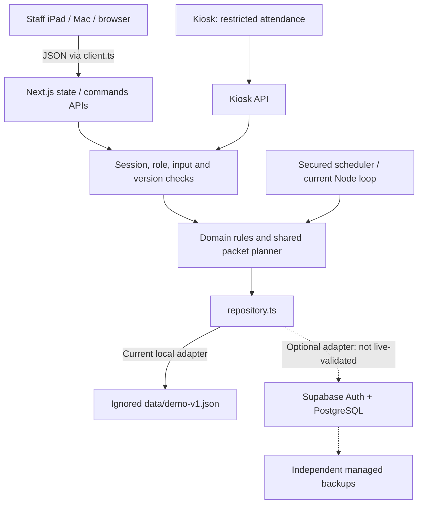

# Centerflow V3 architecture

## Beginner map

The frontend draws the screens; the backend checks and saves changes. Next.js supplies both in one project.

A future Cloudflare host would run the application/API after adapter validation; each iPad would use the same shared server. GitHub stores source, VS Code edits a local checkout, and Codex Cloud runs coding tasks in a separate checkout. None automatically synchronizes runtime student records. See `cloudflare.md` before a future hosting decision.

## Implementation reference

V3 extends the original Next.js application and preserved V2 operations aggregate. It does not create a second app or a new database. V1/V2 domain modules remain for historical compatibility; new daily UI calls V3 commands.

| Module                                   | Responsibility                                                                                                                                                                   |
| ---------------------------------------- | -------------------------------------------------------------------------------------------------------------------------------------------------------------------------------- |
| `model.ts`, `v2-model.ts`, `v3-model.ts` | Existing students/history plus optional visit handoff, student configuration and packet-level fields on existing assignments                                                     |
| `v3-migrate.ts`                          | Explicit schema 2 → 3 addition; preserve original arrays, old settings/records, medals and reports; unknown enrollment dates remain null                                         |
| `v3-planning.ts`                         | One sequencing engine for preparation and Quick View; calendar-day quantities, exact identities, catalog stops, held-packet reuse, recommendations and continuous roster sorting |
| `v3-domain.ts`                           | Validated, role-checked preparation/handoff/receipt/override/repeat/absence/shortcut/catalog commands; stale versions and attribution                                            |
| `v3-analytics.ts`                        | Same-subject filters, deterministic legacy visit matching, verified durations, independently weighted occupancy using real DST intervals                                         |
| V3 components                            | Lightweight Quick View, compact pulling list, directory filters, three-section profile and three relevant student charts                                                         |
| Existing repository/auth/report APIs     | Locks/atomic disk writes or Supabase CAS, durable command IDs, active membership verification, restricted kiosk, append-only reporting versions and jobs                         |

Commands are `{kind:'v3', command:{action:...}, requestId}`. The existing server API maintains idempotency and permissions. Paper-set versions and expected handoff timestamps reject competing edits. Optional observations can be added after departure without a second handoff. Assistants cannot perform instructional actions.

## Truth and physical packets

Physical arrival/departure and instructor handoff are independent. Administrative closure leaves actual departure null/unverified. Every attended session retains its own identity, including repeat same-day visits. The Home roster sorts waiting, ready and departed visits without separate panels.

V3 adapts existing Assignment records through optional `v3` data: visit date, one in-center packet, recommended take-home packets, actual issued packets, held packets, preparation/issuance attribution, version, review and receipt events. Subject + level + exact range is structured identity, not a parsed display string. Packet IDs retain origin when physically reissued. Prepared sets are not silently replaced; changed requirements flag physical adjustment.

The catalog has explicit identifiers/order/bounds and review sources. Unknown legacy Reading identifiers are retained, not guessed into subdivisions. Out-of-bounds ranges produce a review state before any physical pull list. A confirmed position change is an academic decision. One-time repeat preserves the ongoing cursor; explicit restart is separately recorded. Actual manual sets and held ranges inform next preparation.

Incoming no-exception is a planning assumption. Finished/unfinished/missing receipt reports are not verified completion ledger entries. Missing packets cannot become physically available through assumption. Corrections-only shifting applies per subject to entirely unstarted in-center work. A started packet going home requires no classwork-incompletion workflow.

## Migration, persistence and security

The same local file upgrades forward with untouched V1/V2 backup copies. Corruption never causes reseeding. Transactions use a bounded directory lock and atomic replacement; no-op transactions avoid revision growth. The cloud adapter uses revision compare-and-swap and retries side-effect-free callbacks; cloud failures never use local fallback.

The V3 SQL migration permits schema 2/3 payload compatibility, records target schema on commit, and retains existing payload/recovery tables and service-role-only access. No SQL was applied live. Real Auth/RLS/tenant isolation and disaster recovery require external validation. Never run resets or use empty-state provisioning over occupied state.

Records are served through role-filtered APIs. Kiosk pairing removes staff cookies and never exposes private snapshots. The service worker caches only installation assets and a generic offline page; offline mutations are unsupported. No audio files are stored. Browser dictation/provider behavior needs privacy approval.

## Charts and history

Paper academic history projects recorded packet completions and receipt assumptions without converting assumptions into verified ledger entries. Its connected daily position trace can move backward after an explicit repeat. Period views use daily checkpoints for Week, monthly checkpoints for Year, and about fourteen time-distributed checkpoints for the other ranges; the line connects those displayed checkpoints while Page history retains the underlying records; explicit legacy completion dates are respected. Homework consistency uses the latest saved incoming packet snapshot per subject/physical visit to calculate a packet-weighted review percentage. Completed-by-default and reported-finished outcomes contribute to the display numerator while preserving their different source evidence; they never become verified ledger entries. Reissued packets can contribute at a later review, duplicate saves within one review do not, and periods with no review remain unknown rather than zero. Issuance and legacy academic completion records do not provide a review denominator. Duration bars use verified departures. CONNECT subjects omit paper charts/settings.

Visit History merges attendance, observations/evaluations/notes and decisions where a unique match exists. Ambiguous historical entries remain dated entries without fabricated visit links. Existing V2 worksheet history remains readable. Center Activity separately computes arrivals and elapsed-time occupancy; old unresolved visits are excluded, current open intervals are labeled provisional, and DST/midnight intervals use actual elapsed timestamps.

Operational reports remain the existing archive/revision/export system. UI references to removed correction/appointment destinations are suppressed; historical payloads and verified completion records are retained.

The Time spent at center progress card reads `center-duration.ts`, using the existing `measuredMinutes` physical-attendance rule with invalid/negative intervals excluded. Each physical visit remains a separate record. Center-local arrival dates determine calendar buckets; elapsed timestamps determine duration. The headline is visit-weighted and excludes empty buckets. Preview uses eight weekly columns; detail uses daily, weekly or monthly averages and a zero-based, uncapped minutes axis. The projection never writes attendance or assigns attendance time to Math/Reading.

Skill trends are a read-only projection in `skill-progress.ts`. Stable skill IDs and original observation dates identify history; the latest observation revision supplies the score without creating a second event. Current configuration supplies names/order, while historical records retain their original labels. Legacy subject-scoped ratings stay separate from visit-wide series. The shared scatter plot uses only actual saved ratings, aligned by timestamp within center-local calendar boundaries. Straight connections span unrated dates without fabricating dots or extending endpoints. Per-skill arithmetic averages include only ratings inside the selected window. Colors are assigned using all identities rather than the selected period. No schema or command changes are required.

Skills visibility and pins remain per-student in-memory view preferences. The main preview shows four plain pinned skill averages without buttons or pin icons, and a single shaded aggregate line. Its plot geometry stays aligned with Time spent at center. The aggregate is the daily arithmetic mean of every recorded rating, including unpinned skills; missing ratings are excluded. Expanded-only pin controls change preview labels, not the aggregate. Compact selection controls retain individual skill shading, Show all compares skills, and Show average restores the aggregate. The expanded graph has more vertical space; desktop controls retain three columns. No database or attendance changes.
