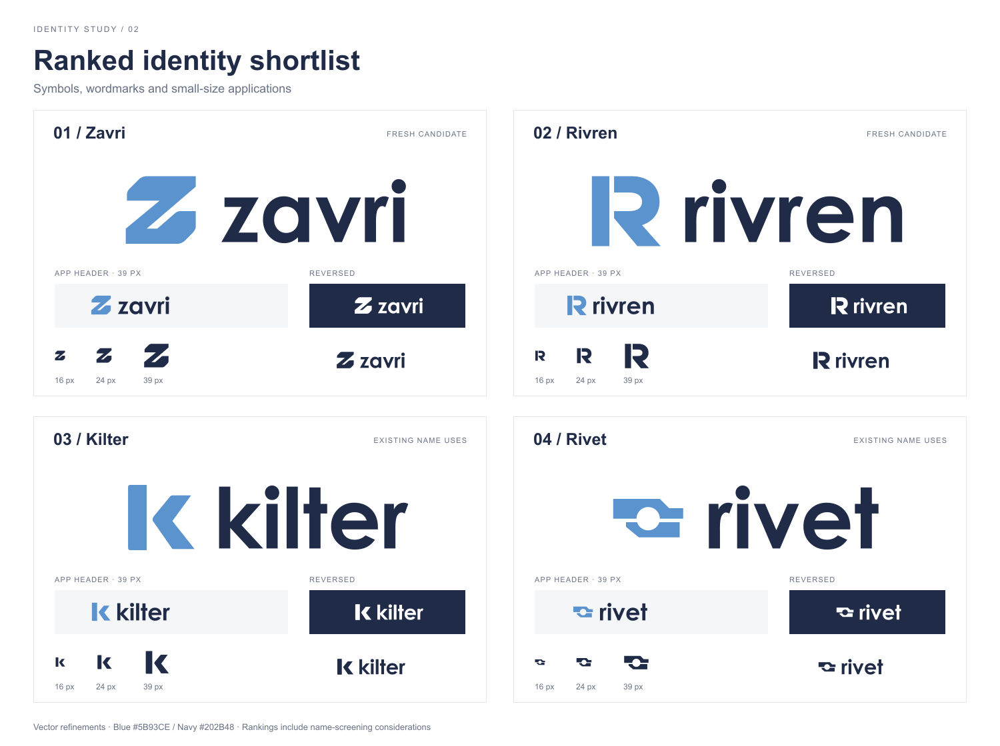

# Ranked name and logo shortlist

2026-10-19 · Second round, following rejection of Folioway, Lessonarc and Handfolio.

Status: the user rejected this visual direction because the shared blue palette, geometric lettering and monograms offered too little variety and felt automotive. Retained as design history, not an accepted identity. The [third round](../round-3/README.md) explores independent palettes, typography and symbol styles.



## Recommendation and ranking

These are design judgments for this application, not measured consumer-recognition scores. The ranking considers the name, the symbol, small-size use, breadth beyond any one feature and the preliminary collision findings together. It is not a ranking solely of how attractive the large logos look.

| Rank | Name and editable logo | Design rationale | Main tradeoff |
| --- | --- | --- | --- |
| **1** | **[Zavri](zavri/logo.svg)** · ZAV-ree | A compact returning Z, with a broad diagonal channel and restrained outer corners. The silhouette carries motion and precision; the short wordmark can cover the entire product. Best overall candidate in this round. | The coined name needs an introduction; Z monograms are a crowded design category. |
| **2** | **[Rivren](rivren/logo.svg)** · RIV-ren | A structural R assembled from a vertical pillar, round bowl and firm diagonal leg. A generous cut keeps the parts distinct at small sizes. The geometric lowercase lettering adds a more approachable tone. | The letter-based symbol is less unusual; pronunciation and spelling need a user reaction before a final choice. |
| **3** | **[Kilter](kilter/logo.svg)** | An offset post and angular bracket suggest a poised K. Simple geometry and open space suit small icons. The name evokes a center working properly across many activities. | Existing technology uses of the name reduce its suitability for this rename. |
| **4** | **[Rivet](rivet/logo.svg)** | Two stepped plates frame a circular opening. This is the strongest connection metaphor: a small, precise joint supporting a larger system. It also has a useful relationship to an engineering portfolio. | Existing operations-software uses are a substantial practical concern. The wide symbol has less vertical presence at small square icon sizes. |

**Take Zavri forward first.** Rivren is the alternative for a more structural, technical character. Kilter and Rivet remain creative explorations rather than cleared rename recommendations.

## What the artwork represents

The app coordinates attendance and QR check-in, student profiles, subject-specific preparation, instructor handoffs, observations and ratings, recorded progress, visit history, center activity and reports. The marks aim to express coordination and continuity across that whole system. They do not illustrate each feature individually.

The primary palette retains the application's blue `#5B93CE` and navy `#202B48`. Each identity also has a single-color and reversed version. The primary symbols have no surrounding badge; an installed-app icon container would be a later, platform-specific composition.

## Files you can use

Each candidate directory contains:

- `logo.svg`: blue symbol and navy wordmark, with a transparent background.
- `logo-mono.svg`: a single navy color.
- `logo-reversed.svg`: white artwork for a dark background.
- `mark.svg`: the standalone symbol using `currentColor` when inlined; black by default.
- `mark-color.svg`: the blue standalone symbol.
- `logo.png`, `logo-mono.png`, `logo-reversed.png`: transparent exports at 1,200px wide.
- `mark.png`: a transparent 512px blue symbol, without an app-icon background.
- `identity-study.png`: the original AI-assisted concept presentation for that name.

The [ranked proof sheet](ranked-logo-shortlist.svg) is also editable vector artwork. The [PNG preview](ranked-logo-shortlist.png) shows the final SVG refinements, including actual 16/24/39px symbol samples and a 39px-high header composition. The symbol inside that header has internal clearance, as it would in an application. The larger image-generation studies are not calibrated size proofs.

## Method and limits

The built-in image-generation tool produced four independent concept studies. The complete [prompt set](prompts.json) is retained. The delivered SVGs were constructed separately from explicit geometry in [marks.json](marks.json), with Century Gothic Bold lettering converted to paths using Windows graphics APIs. Their typography and proportions are vector refinements, not exact pixel traces of the studies. No generated gradients, textures or lighting are carried into the SVGs. No font file or external asset is required to render the delivered logos.

This is AI-assisted design work, not a claim of commissioning a human design agency. The files are reviewable identity concepts; none is claimed to be globally unique or legally cleared.

The preliminary exact-name searches did not surface an obvious same-name software product for Zavri or Rivren. Domain ownership, similar spellings, trademark records and logo-similarity clearance have not been established. Kilter already has [technology uses](https://paddington.io/), and Rivet already has [operations-software uses](https://rivetitops.com/). These existing uses affect the ranking even though the drawings here are independent concepts.

Visual checks cover the rendered sheet, contrasting light/dark presentations and the small symbol samples. PNG transparency and the SVGs' lack of font/image dependencies are checked as artifact properties. No user study, device compatibility or long-term brand-recognition result is claimed.

Only files under `docs/branding/` were created or updated in this round. The app has not been renamed, and no records, installation identity or application behavior changed. The project-required lint, typecheck, 186 unit tests and production build passed after adding the artwork exporters; unit tests used isolated fictional data. No browser suite was rerun because no active application assets or workflows changed. Separately, all 20 standalone SVGs parsed successfully without text, image, script or external-font dependencies; all 16 PNG exports retained transparent and opaque pixels. `git diff --check` passed. Sharp reported an unwritable optional font cache while rendering the comparison sheet; the file rendered successfully and its labels were visually inspected.

## Rebuild the vector refinements

From the repository root on Windows with Century Gothic installed:

```powershell
./docs/branding/round-2/build-svg.ps1
node docs/branding/round-2/render-assets.cjs
```

The first command outlines the lettering and builds the SVG variants. The second uses the project's existing Sharp dependency to export transparent PNGs and the comparison sheet. Neither command reads application records or starts the app.
