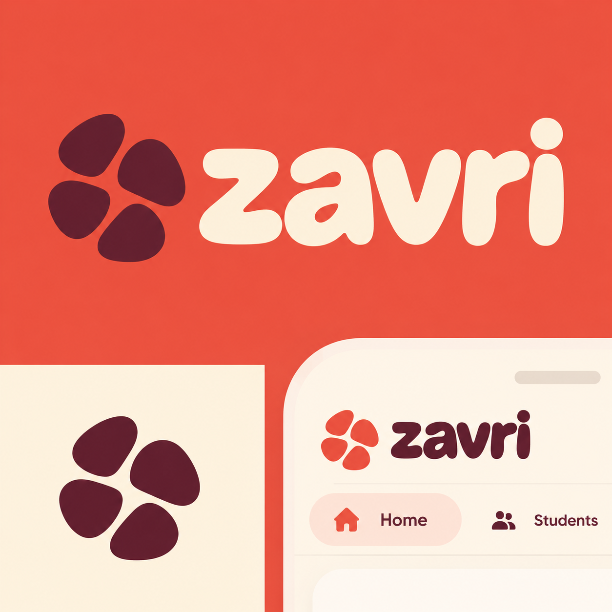
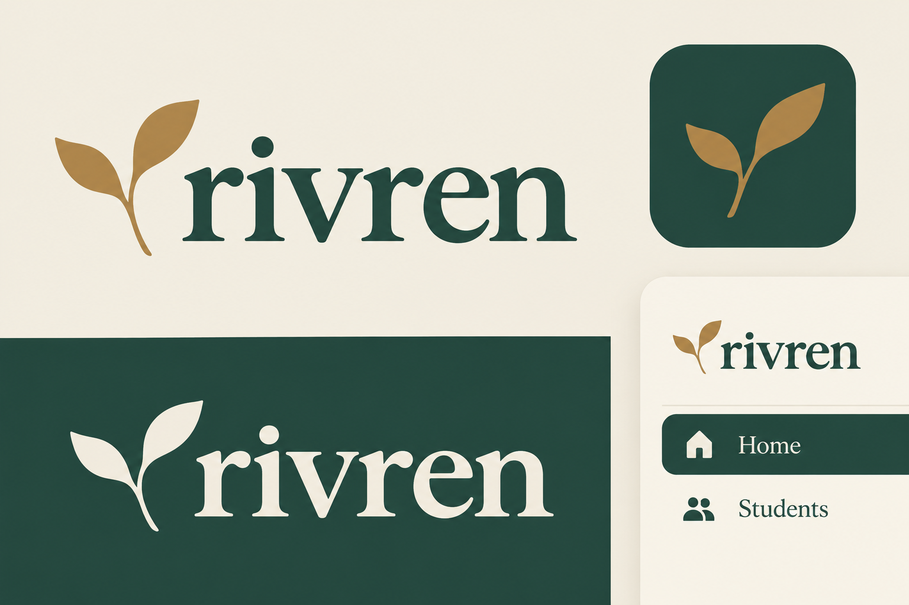
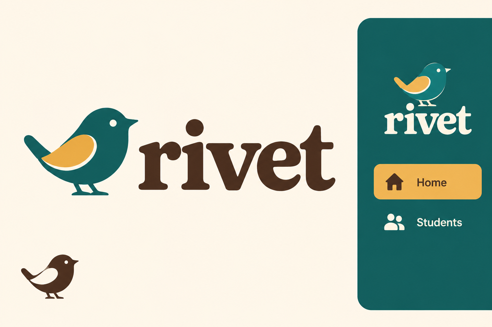
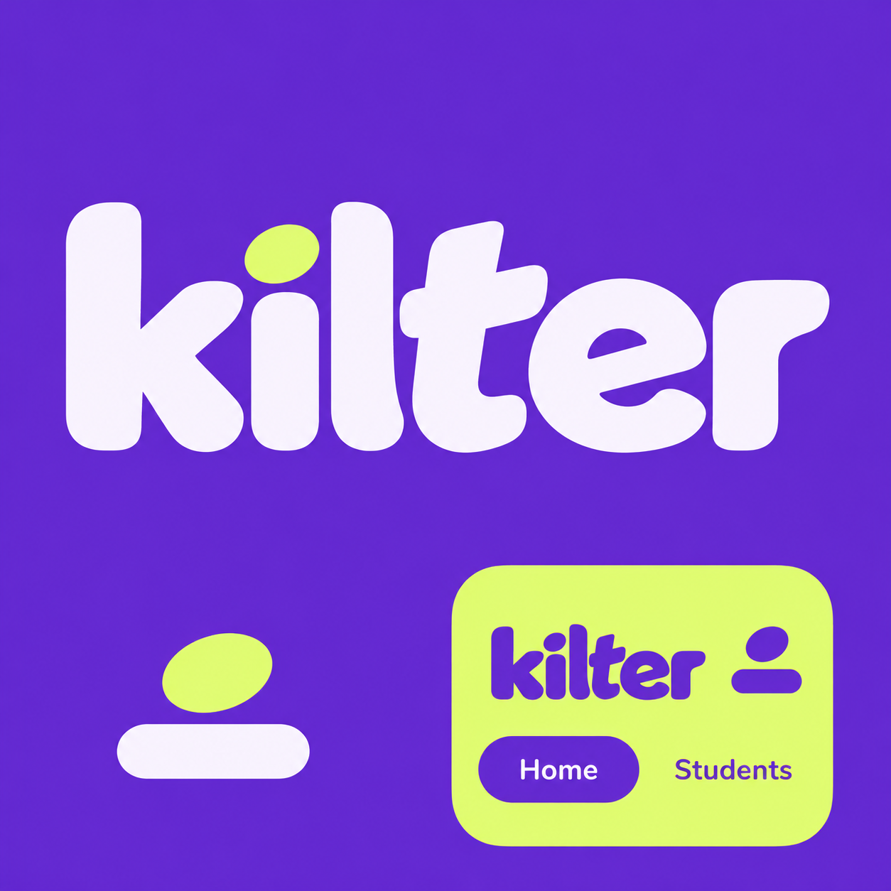

# Four distinct visual directions

2026-10-19 · Third round. The user rejected the shared blue palette, geometric typography and monograms in round two. This pass explores different graphic languages, not recolors of the same design.

Status: the user rejected these concepts as resembling pet food, a hotel, a vape shop and granola branding. Retained as design history. The [fourth exploration](../round-4/README.md) pairs each proposed name and symbol around a purpose grounded in the application.

The names are working labels for comparison. A preferred visual direction can be adapted to a different final name. These studies do not settle the product name or authorize a live rebrand.

## Directions

| Working name | Character | Palette | Typography | Symbol |
| --- | --- | --- | --- | --- |
| **Zavri** | Warm, social, contemporary | Coral `#E65343`, buttercream `#FFF1D8`, burgundy `#4C2432` | Soft, chunky lowercase lettering | Organic gathering of rounded pebble-like petals |
| **Rivren** | Quiet, editorial, thoughtful | Forest `#21483D`, parchment `#F3EFE3`, ochre `#B68A46` | Warm humanist serif | Simplified hand-inked sprig |
| **Kilter** | Bold, expressive, digital | Plum `#632CCB`, chartreuse `#DDF66A`, pale lilac `#F9F5FF` | Custom heavyweight display wordmark with an offset dot | Small balancing oval and rounded stroke |
| **Rivet** | Illustrated, friendly, human | Teal `#176D68`, cream `#FFF6E7`, ochre `#E7AE39`, cocoa `#443126` | Soft slab serif with a hand-lettered rhythm | Simplified round-bodied bird |

Each brief includes a primary logo, a standalone symbol and an app-corner sample in that direction's own scheme. The little interface fragments are visual concepts, not actual application screenshots or changes to the app.

## Visual ranking after reviewing the artwork

This ranking concerns visual direction, independently of final name selection or availability.

1. **[Coral / Zavri](01-coral-zavri.png):** the strongest fit for an approachable daily workspace. A warm palette, organic gathering symbol and soft lettering replace the previous automotive feel. The lettering may need restraint during production so it remains suitable for adult staff.
2. **[Forest / Rivren](02-forest-rivren.png):** the strongest quiet option. Serif lettering and a sprig give it an editorial, attentive character. It is less energetic than the coral direction, and the botanical idea will need further distinction from common growth logos.
3. **[Illustrated / Rivet](03-illustrated-rivet.png):** the most character-led direction. The small bird is memorable and can stand alone. It risks feeling more like a children's product, so a final version should keep the illustration understated and prove its small-size simplification.
4. **[Plum / Kilter](04-plum-kilter.png):** the boldest and highest-energy direction. The shifted lettering and offset dot have personality. The large lime panel is a graphic presentation choice; a full everyday workspace would need more restraint. The simple standalone balance motif currently communicates a person/profile more readily than a distinctive brand.

### Artwork

## Artwork and method

Four independent new images were generated using the built-in image-generation tool. No previous logo was supplied as a reference. The complete prompt set is retained in `prompts.json`. The outputs are identity studies, not final SVG masters or calibrated favicon proofs. Once a direction is selected, its actual lettering, symbol geometry, contrast and small-size variants need a focused production pass.

Visual review confirmed the intended working names and the Home/Students text, with distinct palettes and symbol treatments. The generator introduced slight tonal shading and some presentation effects despite flat-art requests. Those are not proposed production-logo effects. The forest and bird studies have finer details that are not yet validated at actual favicon sizes. None of these raster studies should be treated as an integration-ready logo file.

No brand is claimed to be globally unique or cleared. Prior screening found existing technology uses for Kilter and Rivet; this round compares their visual directions without renewing those names as cleared rename recommendations. The previous screening notes remain in [round two](../round-2/README.md).

## Application checks

Only branding artifacts and design-history notes were edited in this round. Lint, typecheck and 186 unit tests passed early in the session. A subsequent production build encountered two TypeScript errors in the concurrently added `tests/center-features.test.ts`: `mode` and `assignmentIds` were being accessed on a value narrowed to `never`. That file is outside this branding work and was not edited here. After the parallel application work changed, the build retry passed, including Next's TypeScript step, and all 195 unit tests passed. No browser suite was run for these inactive visual concepts. `git diff --check` passed.
