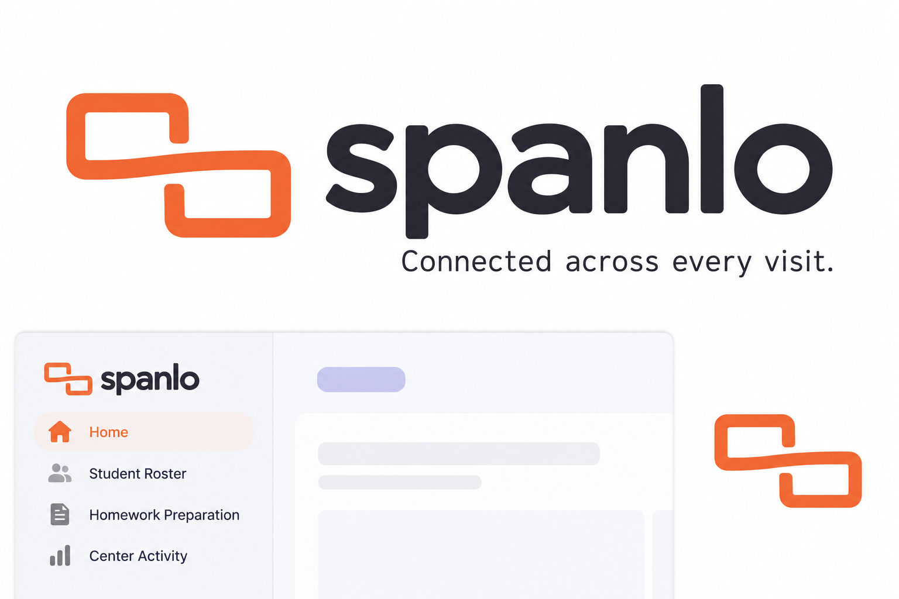
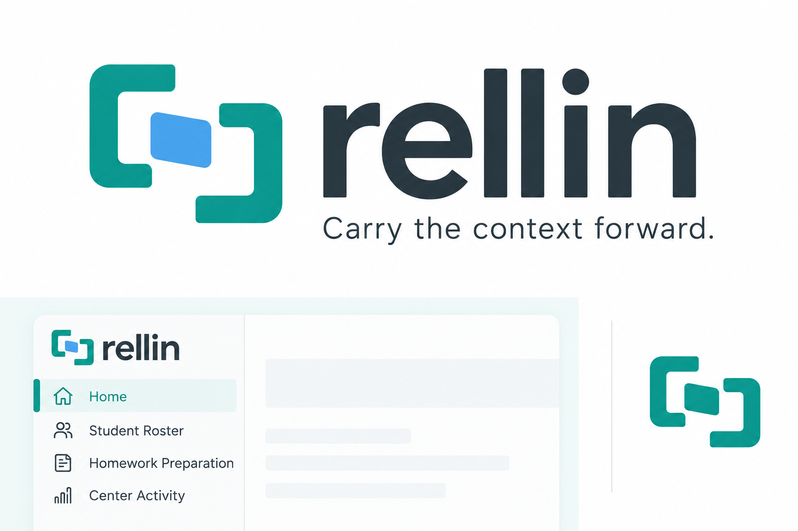

# Names and symbols built from the application

Status: superseded by [round 5](../round-5/README.md). User feedback: an improvement on prior rounds, but the names and symbols still felt generic and lacked the dark, intricate character desired. Retained as exploration history.

2026-10-19 · Fourth exploration. The previous style studies were rejected as pet-food, hotel, vape-shop and granola branding. This round starts with the application's purpose and develops each name together with its symbol.

## Product premise

**A shared workspace that keeps student context connected while staff coordinate the learning day.**

The code gives this premise concrete meaning:

- Attendance and QR check-in establish physical presence; instructor handoff and subject check-ins have their own records and permissions.
- Quick View brings incoming work, the current activity, outgoing work and observations into one student/visit context.
- Visit History, skill ratings, academic charts and reviewed observations retain context across visits. Center Activity and reports give staff a broader view.
- Homework can be disabled while activity check-ins, attendance, skill ratings and duration/history remain useful. The identity should cover both configurations.

Reviewed sources: [architecture](../../architecture.md), [center features](../../../src/lib/center-features.ts), [domain commands](../../../src/lib/v3-domain.ts), [progress views](../../../src/components/v3-progress.tsx), [staff workspace](../../../src/components/staff-app.tsx).

## Ranked concepts

### 1. Spanlo — SPAN-loh

The proposed name is built around **span**: across visits, across staff and across the center's connected workflows. Two offset record frames share a continuous line, making that same connection visible in the symbol.

Graphite type and persimmon orange give it a practical software identity. Its broad idea covers activity-only and paper workflows. Supporting copy: **Connected across every visit.**

This is the stronger overall candidate in this pair. The symbol still needs small-size refinement and a comparison against existing linked-frame marks.

### 2. Rellin — REL-in

The proposed name is inspired by **relay** and **line**: staff carry work and context forward. Two receiving forms share one context tile, so the name and mark express the same handoff idea.

Teal and sky blue, upright type and restrained surfaces place it in a software-workspace setting. Supporting copy: **Carry the context forward.**

The concept is direct, though its emphasis on handoff is narrower than Spanlo's continuity idea. The tile and brackets need refinement to avoid a generic file-transfer/integration identity.

## Status, method and checks

These are two AI-assisted raster identity studies generated with the built-in image-generation tool. The [complete prompts](prompts.json) are retained. They are not final vector masters, actual app screenshots, validated icon-size proofs or accepted names. The slight generated shading and presentation effects are not proposed production-logo details. No runtime code, app branding or records were changed.

Preliminary searches did not surface an obvious same-name app for either candidate; Spanlo appears incidentally in technical/historical material, and Rellin appears as a surname and company name. These are not claims of global uniqueness, domain availability or trademark clearance. Names considered and excluded included [Tandri](https://softdev23.com/tandri/), [Tandio](https://tandio.work/) and [Iterli](https://iterli.eu/), which already have software uses.

Project-required lint, typecheck, all 197 unit tests and production build passed. Unit tests use isolated fictional fixtures. No browser suite was rerun for these inactive concept images. `git diff --check` passed.
